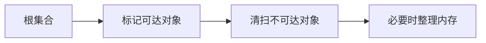

# 笔记

同一目录下两类 Markdown 产物：知识笔记解决一个具体问题，速查卡给一个领域的知识骨架。两类共用覆盖账本、目录与写作规范，各自的结构与模板见专节。

## 覆盖账本

完整读取材料，记录有意义的知识点，合并语义重复并保留来源位置；为每项标出产出位置或排除理由。材料外的未知知识点可联网检索补充。

## 目录

按概念体系划分笔记顶级目录，速查卡可选，知识笔记平铺：

```text
{笔记顶级目录}
├── 000-cheatsheet.md      # 速查卡源
├── 000-cheatsheet.png     # 速查卡成品，由源渲染
├── {NOTE-1}.md            # 知识笔记
└── {NOTE-2}.md            # 知识笔记
```

## 写作规范

- 段落使用 `标签: 结论 + 解释;`，使用教科书式的分层说明风格；
- 语言简单直白，面向硕士水平的初学者；适当但不滥用专业术语；
- 每节条数：均值 3.5，P50 3.0，P90 6.0；超 8 条只占 2.2%，超过 6 条考虑拆成两个小节；
- 支持代码块、表格、公式、图示、 mermaid（语言标记 `mermaid`，适用于状态流转、时序、流程图）富文本格式；富文本格式用于关键概念的示例与系统理解，正文用于富文本格式的解释；
- frontmatter 写 `id` 与 `anki`：`id` 为稳定 UUID，Anki 卡片复用；`anki` 缺省 true，`anki: false` 不制卡。

## 知识笔记

知识笔记解决一个领域中的具体问题；读者读完后能完整复述（费曼技巧），不依赖其他笔记。

### 结构

- 一个 H1，用问题形式；正文完整回答，不写标题未声称的内容；
- 第一个 H2 固定为「常见问题」：直接列问题原文，保持原措辞；没有原文时再列实际疑问；
- 第二个 H2 为「概念索引」：用列表列出概念与编排关系；
- 每个知识点只写一处完整解释，其他位置只作指向。
- 不设 `## 参考` 章节；需要来源时在对应正文内联链接。
- 单条段落默认 55 字以内，按内容需要可以超过；

### 模板

````markdown
---
id: <uuid>
anki: true
---

# JavaScript 的垃圾回收怎么做?

## 常见问题

- 简述 JavaScript 垃圾回收的原理

## 概念索引

- 根集合: 全局对象、调用栈上的局部变量、闭包环境;
- 新生代: 存活时间短的对象, 用复制式算法回收;
- 老生代: 熬过多次回收的对象, 用标记清扫与整理;

## 三种回收算法分别是什么?

| 算法      | 过程                                 | 用在哪 |
| --------- | ------------------------------------ | ------ |
| 停止-复制 | 存活对象复制到另一半空间, 再交换角色 | 新生代 |
| 标记-清扫 | 标记存活对象, 清理未标记的           | 老生代 |
| 标记-整理 | 标记后把存活对象挪到一侧, 消除碎片   | 老生代 |

- 停止-复制: 只处理存活对象, 用空间换时间, 需要短暂暂停执行;
- 标记-清扫: 不挪动对象, 快但会留下内存碎片;
- 标记-整理: 挪动对象消除碎片, 代价是搬移开销;


````

## cheatsheet

cheatsheet 是将复杂知识浓缩在一两页纸上的精华指南。用于快速检索，梳理知识框架；实现细节由知识笔记承接。

### 取材

- 材料分两类：逆向材料是官方答案（考试、习题、标准代码、高频知识笔记），参考材料是教材、课件、文档；
- 逆向驱动：先把逆向材料里对应的知识点逐条列出，这张「知识点」清单就是骨架，按题频排收录顺序；
- 参考材料梳理体系结构，把骨架补成「知识体系 × 高频知识」；照参考资料章节顺序正向总结，只会得到一张考场上用不上的笔记；
- 篇幅默认按源材料长度的 3%，是上限不是配额。

### 结构

- 区（`##`）是知识框架的骨架，按概念族与边界切，不照抄材料章节；
- 子区（`###`）是区里最细的知识点，一个子区只讲一件事；

### 版面

- A4 横向、固定 4 栏、默认 5pt；页数优先，字号在 4~6pt 内调；
- 控制单条段落行数 <= 3 行，即小于 144 字左右，默认长度在 1 - 2 行；
- 多页时末页可留白；不为凑页均分内容。

### 出图

- 产物只有源与拼接图两个，平铺在目标目录；`page-N.png` 等中间件只落系统临时目录；
- 源在 frontmatter 后空一行，第一行引用拼接图 ``，正文从下一个 H2 起。

```bash
node scripts/render-sheet.mjs <目标目录> --source <源材料> --fit 2
```

### 模板

```markdown
---
id: { 稳定 UUID }
anki: false
title: 计算机网络
---


## 计算机网络体系结构

### 分层结构

| 层   | 数据单元（PDU）                  | 核心职责                                                 | 典型协议                                  |
| ---- | -------------------------------- | -------------------------------------------------------- | ----------------------------------------- |
| 应用 | 报文                             | 定义应用间的交互规则，用域名与 URL 表示                  | HTTP、HTTPS、DNS、FTP、SMTP               |
| 运输 | 报文段（TCP）、用户数据报（UDP） | 提供端到端的进程间通信，负责可靠传输、流量控制与拥塞控制 | TCP、UDP、QUIC                            |
| 网络 | 数据报（分组）                   | 负责跨网络寻址与路由转发                                 | IP、ICMP                                  |
| 链路 | 帧                               | 处理相邻节点间的寻址、介质访问与差错检测                 | Ethernet、PPP、VLAN、802.11               |
| 物理 | 比特（符号）                     | 在传输介质上传输原始比特流，定义电信号、光信号与物理接口 | 不定义协议，1000BASE-T、RS-232 属物理规范 |

- OSI 七层: 自下而上为物理层、数据链路层、网络层、传输层、会话层、表示层、应用层，用于理论教学；
- TCP/IP 四层: 将 OSI 七层中的物理层与数据链路层合并为网络接口层；
- 五层协议体系结构：将 OSI 七层中的会话层、表示层、应用层合并为应用层；

### 各层核心职责与常见协议

- 应用层：面向用户应用，定义应用间交互规则，数据单元常称“报文”（如 HTTP、HTTPS、DNS、FTP）；
```

## 收尾

每次调用都跑一次校验脚本并进行修正，覆盖本轮全部产出目录，实测值对照「写作规范」的参考值：

```bash
python3 scripts/note-metrics.py <笔记目录>... [--detail] [--json] [--exclude <路径子串>]
```

出过速查卡时确认拼接图已由最新的源重新渲染。
